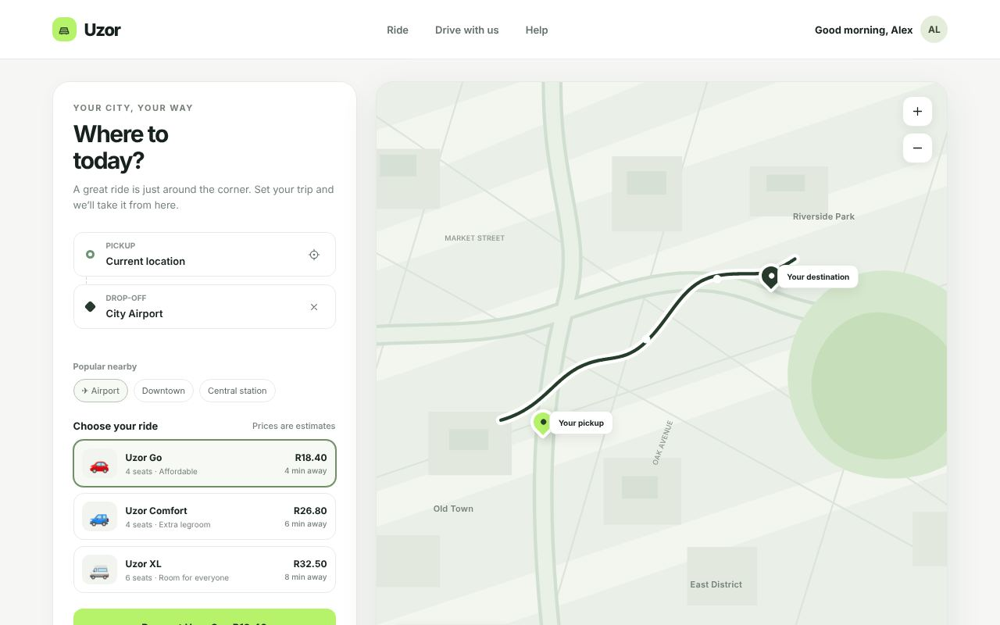

# Uzor — rides made easy

A responsive ride-hailing booking page, built with plain HTML, CSS and JavaScript.

**Live site: [ukhezo.github.io/Uzor-ehailing](https://ukhezo.github.io/Uzor-ehailing/)**



## Features

- **Book a trip:** enter a pickup and drop-off, or tap a popular place (Airport, Downtown, Central station).
- **Use my location:** sets the pickup with the browser's Geolocation API, with clear messages if location is unavailable or blocked.
- **Choose a ride:** Uzor Go, Comfort or XL, each with seats, price in rands and how far away the driver is.
- **Live route map:** the map shows the pickup, destination and route once a trip is set.
- **Ride confirmation:** a trip status card and toast message confirm the booking, and the ride can be cancelled.
- **Form validation:** the destination is required, with a friendly message if it's left empty.
- **Driver and help panels:** “Drive with us” and “Help” open accessible pop-up panels (native `<dialog>`, closes with Esc or a click outside).
- **Personal greeting:** says good morning, afternoon or evening based on the time of day.
- **Responsive:** the layout switches to a single column on tablets and phones, with the map on top.
- **Accessible:** ride options work as a keyboard-friendly radio group with ARIA labels.

## Built with

- HTML5
- CSS3 (custom properties, Grid, Flexbox, media queries)
- Vanilla JavaScript (DOM events, form validation, Geolocation API, `<dialog>`)

No frameworks, build tools or dependencies.

## Run it locally

1. Clone the repository:
   ```bash
   git clone https://github.com/Ukhezo/Uzor-ehailing.git
   ```
2. Open `index.html` in your browser.

## Project structure

```
Uzor-ehailing/
├── index.html          # Page markup, styles and scripts
├── images/
│   └── screenshot.jpg  # README screenshot
├── LICENSE
└── README.md
```

## Possible next steps

- Connect a real map (Leaflet or Google Maps) and live price estimates
- Add sign-in, trip history and payment options
- Add a driver app view

## License

[MIT](LICENSE) © 2026 Ukhezo
